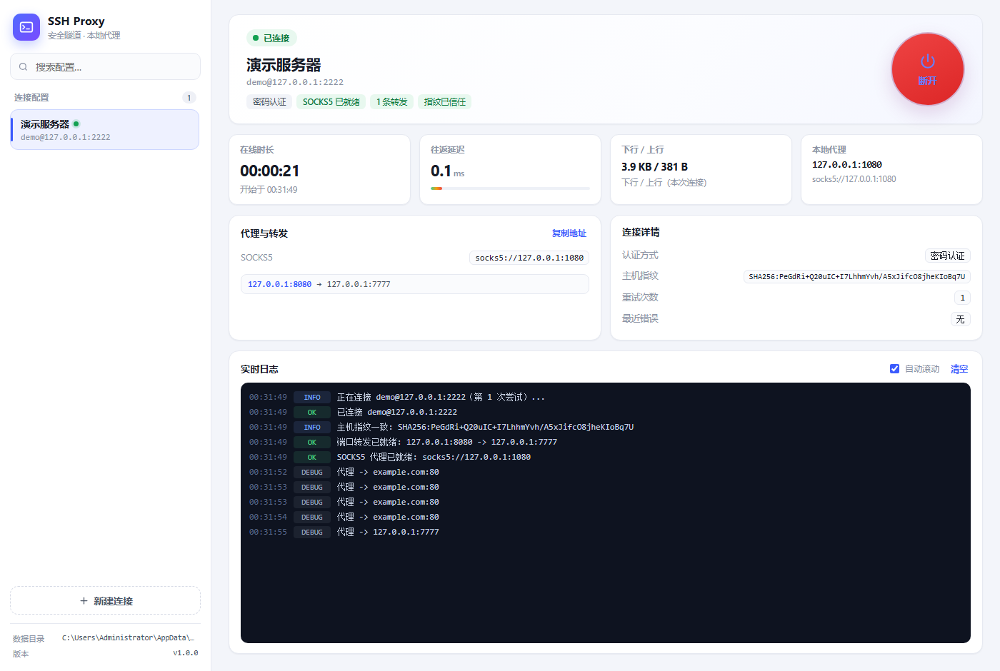
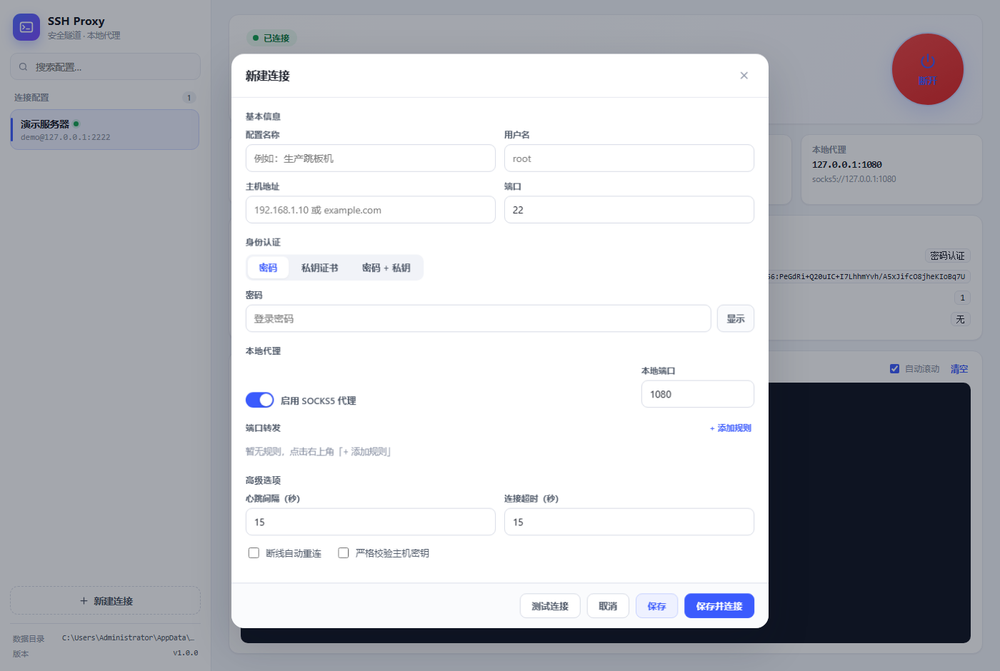

# SSH Proxy · 带图形界面的 SSH 代理工具

用 Go 编写的 SSH 代理工具：一条 SSH 连接同时提供 **SOCKS5 本地代理** 和 **本地端口转发**，
界面实时显示连接状态、在线时长、往返延迟、上下行流量与完整日志，可随时连接 / 断开。



## 功能

- **多种认证方式**：密码、私钥证书（含 passphrase 加密私钥）、密码 + 私钥双认证
- **完全自定义**：主机、SSH 端口、用户名、密码 / 私钥、本地 SOCKS 端口、转发规则、心跳与超时
- **SOCKS5 代理**：连接后在本机开启 `socks5://127.0.0.1:<端口>`，所有流量走 SSH 隧道
- **端口转发**：支持多条 `本地端口 -> 远端地址:端口` 规则（例如把服务器的 3080 映射到本机 3080）
- **实时状态**：状态胶囊（连接中 / 已连接 / 重连中 / 失败）、在线时长、延迟曲线、上下行流量、逐行日志
- **一键连接 / 断开**：断开时立即释放本地监听端口
- **断线自动重连**：指数退避（2s → 4s → … → 30s，最多 8 次）
- **主机指纹校验**：首次连接记录 SHA256 指纹，可开启「严格校验」，指纹变化会拒绝连接
- **配置管理**：多套配置保存到本地，支持搜索、编辑、删除、双击快速编辑
- **测试连接**：保存前先探测 TCP 耗时、握手耗时、延迟与服务器版本
- **常驻托盘**：最小化或关闭窗口都会缩到右下角托盘，代理继续在后台静默运行
- **托盘菜单**：右键托盘图标即可打开界面 / 连接 / 断开 / 退出，无需打开窗口
- **全局单实例**：双击多少次都只有一个进程，后启动的会自动退出并把已有窗口唤到前台



## 快速开始

1. 双击 `ssh-proxy.exe`
2. 程序会在本机启动服务、挂上托盘图标，并打开应用窗口（Chrome/Edge 应用模式，看起来就是一个独立窗口）
3. 点击左下角 **新建连接**，填写主机、端口、用户名、密码或私钥
4. 保存后点击右上角圆形按钮 **连接**

> 默认地址 `http://127.0.0.1:7777`，端口被占用时会自动顺延（7778~7790）。
> 重复双击 exe 不会启动第二个实例，只会把已运行的窗口唤到前台。

### 托盘与后台运行

- 点窗口的 **最小化** 或 **关闭**，窗口都会收进右下角托盘，SSH 隧道和本地代理继续工作
- 单击 / 双击托盘图标 → 重新打开界面；右键 → 菜单（打开界面 / 连接 / 断开 / 退出）
- 托盘图标鼠标悬停会显示当前状态，例如「已连接 root@192.168.1.10」
- **退出程序**：右键托盘图标 → 退出（所有监听端口随之释放）
- 从终端启动时会挂到父控制台，日志照常打印；双击启动时没有任何控制台窗口，直接出界面

### 全局单实例

无论双击多少次 exe，系统里始终只有一个 `ssh-proxy.exe` 进程，不会出现「两个进程抢同一个代理端口」的情况。

- **用内核命名互斥体判定**（`Global\SSHProxy.SingleInstance`，无权限时退回 `Local\`）。
  `CreateMutexW` 是原子的，两个进程同时启动也只有一个能拿到；进程被强杀时由系统自动释放，
  不会像锁文件那样留下「僵尸锁」导致再也打不开。
- **后启动的实例只做一件事**：找到正在运行的那个实例的地址
  （先读 `%AppData%\SSHProxy\instance.json`，再试默认端口，最后扫 7777~7790），
  把它的窗口 `SW_RESTORE` 拉出托盘并置前，然后自己立刻退出（实测约 100ms）。
  所以「窗口已经缩到托盘 → 又双击了一次 exe」的效果就是窗口重新弹回来。
- **双保险**：互斥体之外还会用 `GET /api/meta` 探测是否已有本程序在服务，
  这样从旧版本（没有互斥体）升级过来的瞬间也不会同时跑两个实例。

### 命令行参数

| 参数 | 说明 |
| --- | --- |
| `--addr 127.0.0.1:7777` | 指定界面监听地址（默认仅本机可访问） |
| `--no-browser` | 不自动打开界面窗口 |
| `-v` | 显示版本号 |

### 使用 SOCKS5 代理

```bash
# curl
curl --socks5-hostname 127.0.0.1:1080 http://example.com

# 浏览器 / 系统代理：选择「SOCKS5」，地址 127.0.0.1，端口 1080
```

### 使用端口转发

在配置里添加一条规则即可，例如把服务器上的 3080 映射到本机：

| 本地端口 | 目标主机 | 目标端口 |
| --- | --- | --- |
| 3080 | 127.0.0.1 | 3080 |

连接成功后访问 `http://127.0.0.1:3080` 就等于访问服务器上的 `127.0.0.1:3080`
（目标主机写 `127.0.0.1` 表示「从服务器视角看」的本机）。

## 配置项说明

| 配置 | 说明 |
| --- | --- |
| 认证方式 | 密码 / 私钥证书 / 密码 + 私钥 |
| 私钥文件 | 支持 `id_rsa`、`id_ed25519` 等，可点「浏览…」选择，或从扫描到的 `~/.ssh` 中快速选 |
| 粘贴私钥 | 也可以直接把私钥内容粘进来，程序会以 600 权限保存到数据目录 |
| 私钥口令 | 加密私钥的 passphrase |
| 本地端口 | SOCKS5 监听端口，默认 1080 |
| 端口转发 | 多条规则，可备注 |
| 心跳间隔 | 用于保活与延迟测量，默认 15 秒（最小 5 秒） |
| 连接超时 | TCP 连接与 SSH 握手超时，默认 15 秒 |
| 断线自动重连 | 非主动断开时自动重试 |
| 严格校验主机密钥 | 开启后指纹不匹配将拒绝连接 |

## 数据与安全

- 配置保存在 `%APPDATA%\SSHProxy\`（`profiles.json`、`known_hosts.json`、`keys\`）
- 密码与私钥为本地明文存储，仅建议在个人电脑使用
- 界面服务与 SOCKS5 均只监听 `127.0.0.1`，不对外网开放
- 主机指纹首次连接时记录（TOFU），开启严格校验后指纹变化会阻断连接

## 项目结构

```
main.go                     启动、监听端口、打开界面窗口
internal/store/             配置与主机指纹持久化
internal/sshx/              SSH 连接管理、统计、重连、端口转发
internal/socks/             SOCKS5 服务端（仅 CONNECT，无认证）
internal/api/               HTTP 接口 + SSE 实时推送 + 静态资源
internal/winapp/            Win32 外壳：系统托盘、窗口图标接管、最小化到托盘
web/                        界面（原生 HTML/CSS/JS，编译时内嵌进 exe）
assets/icon-256.png         图标母版（另含官方逐尺寸 icon-16/24/32/48.png）
build/app.ico               生成的多尺寸图标（16~64 全尺寸 + 72/80/96/128/256）
rsrc_windows_amd64.syso     Windows 图标 + 版本信息资源（go build 自动链接）
tools/mkico/                PNG -> 多尺寸 ICO（裁透明边 + 面积平均缩放）
tools/icoinfo/              解析 ICO 并导出各尺寸 PNG（校验用）
tools/checkicon/            检查 exe 内图标/版本资源是否真的嵌入
tools/testserver/           本地测试用 SSH 服务端（非发布产物）
```

## 自行编译

```bash
# 单文件 exe（界面已内嵌，GUI 子系统 —— 双击不弹黑窗）
go build -ldflags "-H windowsgui -s -w" -o ssh-proxy.exe .
go build -o testserver.exe ./tools/testserver   # 可选：本地测试服务端
```

依赖仅 `golang.org/x/crypto`，无需 CGO，可交叉编译到 macOS / Linux。

> `-H windowsgui` 让程序以 GUI 子系统启动，双击不会出现黑色控制台窗口。
> 从 cmd / PowerShell 启动时会自动 `AttachConsole` 到父控制台，日志照常打印。

### 图标与版本信息

exe 的图标由 `rsrc_windows_amd64.syso`（Windows 资源对象文件）提供，`go build` 会自动链接它。
图标源图放在 `assets/`（`icon-256.png` 母版 + 官方逐尺寸 `icon-16/24/32/48.png`），重新生成资源：

```bash
go run ./tools/mkico --dir assets build/app.ico             # 生成多尺寸 ico（推荐）
go run ./tools/mkico assets/icon-256.png build/app.ico      # 只有一张母版时用这个
go run ./tools/mkico --png assets/icon-256.png web          # 导出网页 favicon
go run github.com/tc-hib/go-winres@latest simply ^
  --arch amd64 --icon build/app.ico --manifest gui ^
  --product-name "SSH Proxy" --file-description "SSH 代理工具（图形界面）" ^
  --file-version 1.1.2.0 --product-version 1.1.2.0 ^
  --original-filename ssh-proxy.exe --out rsrc               # 生成 syso
go build -ldflags "-H windowsgui -s -w" -o ssh-proxy.exe .    # 重新编译（GUI 子系统，无黑窗）
go run ./tools/checkicon ssh-proxy.exe                       # 校验资源是否嵌入
```

### 任务栏图标为什么能保持锐利

网页窗口（Chrome/Edge app 模式）默认拿 favicon 当图标，缩放到任务栏尺寸一定发虚。这里做了三件事：

1. **接管窗口图标**：程序用 `WM_SETICON` 把窗口图标换成内嵌的多尺寸 ICO，并每 300ms 校验一次，
   Chrome 用 favicon 覆盖后会被立刻抢回来。
2. **按 DPI 精确供图**：进程启动时开启 Per-Monitor DPI 感知，按 `GetDpiForWindow` 算出任务栏
   真正要画的像素尺寸（Win11 任务栏图标是 24 逻辑像素，150% 缩放即 36px），直接加载同尺寸图标，
   Windows 不再插值放大。
3. **ICO 预置全部尺寸并裁掉透明边**：`mkico` 会生成 16~64 每一个整数尺寸 + 72/80/96/128/256，
   保证任何缩放比例都能命中"完全一致"的那张；同时裁掉官方图标四周约 10% 的透明边，
   让图形铺满画布，视觉大小与 Chrome、微信等应用一致（否则会显得小一圈、发糊）。


## 已验证场景

- 密码认证连接内网服务器（`root@192.168.x.x:22`），SOCKS5 `127.0.0.1:1080` 正常出网
- 端口转发 `127.0.0.1:3080 -> 127.0.0.1:3080`（服务端 3080 服务可正常访问）
- 私钥（ed25519）认证、严格指纹校验
- 错误密码失败提示、断开后端口释放、服务端重启后自动重连
- 150% 缩放（3840×2160 / DPI 144）下任务栏图标按 36px 原生渲染，与 Chrome、微信同等清晰
- 双击启动无控制台窗口；最小化 / 关闭窗口后缩到托盘，隧道继续运行
- 连续启动 4 次只保留 1 个进程，后 3 次均在 ~100ms 内退出；强杀后互斥体自动释放，可正常再启动
- 窗口已缩到托盘时再次双击 exe，原窗口被恢复可见并置前，界面进程数不增加（不会开出第二个窗口）
